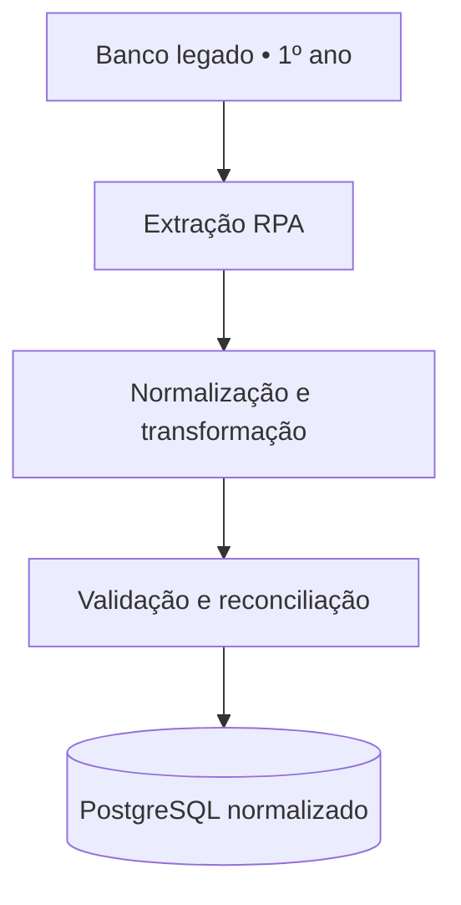
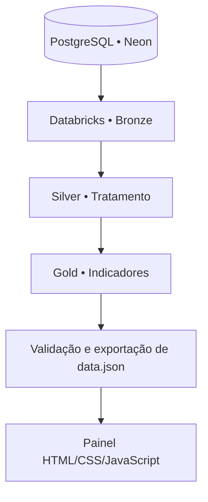
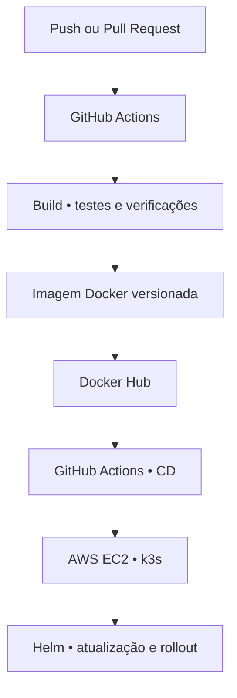
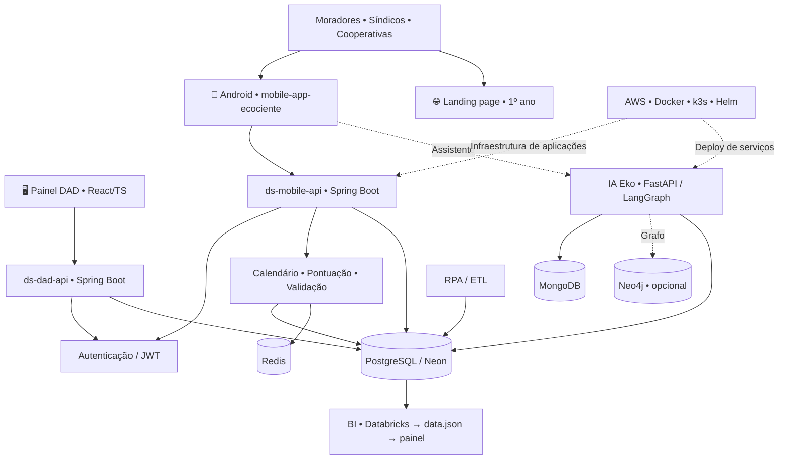

<!--
  ECOCIENTE | README DA ORGANIZACAO
  Local final: EcoCiente-Instituto-J-F/.github/profile/README.md
  Banner futuro: assets/readme/banner/press-start-eko.gif
  Todas as imagens opcionais ainda nao criadas ficam comentadas para nao exibir icones quebrados.
-->
Card README - Organização EcoCiente (GitHub).png
<!-- BANNER PRESS START: depois de enviar o arquivo para .github/assets/readme/banner/press-start-eko.gif,
     descomente o bloco seguinte e retire o titulo textual abaixo, se a imagem ja contiver o titulo.

  

-->

  

<h1 align="center">ECOCIENTE</h1>

<strong>Conectamos pessoas, condomínios e cooperativas para transformar a relação com os resíduos.</strong>

<a href="#a-missao"><kbd>▶ PRESS START</kbd></a> &nbsp; <code>EDUCAÇÃO • TECNOLOGIA • IMPACTO</code>

  
  
  
  

  <a href="https://github.com/EcoCiente-Instituto-J-F/mobile-app-ecociente">📱 Mobile</a> ·
  <a href="https://ecociente-instituto-j-f.github.io/dad-crud/">🖥️ Painel DAD</a> ·
  <a href="https://github.com/EcoCiente-Instituto-J-F/ia-eko">🤖 IA Eko</a> ·
  <a href="https://github.com/EcoCiente-Instituto-J-F/bi-ecociente-painel">📊 BI</a> ·
  <a href="https://github.com/EcoCiente-Instituto-J-F/devops-infra-ecociente">☁️ DevOps</a>

---

## 🎮 01 · A missão

**E se aprender a cuidar do planeta também fosse uma experiência envolvente?**

O **EcoCiente** é um projeto interdisciplinar do **Instituto J&F / Germinare Tech** que combina **educação ambiental, tecnologia e organização de coletas seletivas**. A plataforma aproxima moradores, síndicos, gestores e cooperativas e oferece ferramentas para transformar informação em participação.

O projeto reúne esforços do **1º e do 2º ano**, conectando pesquisa, experiência do usuário, páginas web, programação orientada a objetos, aplicativos móveis, APIs, inteligência artificial, modelagem de dados, BI e infraestrutura em nuvem.

**Nossa missão:** tornar a sustentabilidade mais simples e acessível, promovendo consumo consciente, descarte correto e participação de diferentes comunidades — em sintonia com a **ODS 12: Consumo e Produção Responsáveis**, especialmente a meta 12.8 de informação e conscientização.

**Pilares do projeto:** `♻️ Coleta seletiva` · `📚 Educação ambiental` · `🤝 Conexão com cooperativas` · `🎮 Gamificação` · `♿ Inclusão digital` · `📈 Dados e impacto`

---

## 🌍 02 · Um ecossistema, muitas disciplinas

O EcoCiente não nasceu como uma única tela. Seu desenvolvimento combina entregas complementares e uma visão de produto que conecta experiências de diferentes disciplinas e séries.

### 🪴 1º ano · Conceito, experiência e primeiras aplicações

O trabalho do 1º ano contempla a **apresentação da solução para o público**, os fundamentos de UX, banco de dados, desenvolvimento web e lógica, além de uma **aplicação administrativa em Java com Servlets, DAO, JSP e JDBC**.

- **UX e pesquisa:** problema, público, persona, jornadas, testes e prototipação.
- **Landing page:** comunicação do propósito, benefícios, funcionalidades e público atendido.
- **Banco de Dados 1:** modelagem conceitual/lógica, SQL e estrutura de dados do projeto.
- **Programação e POO:** organização de código, persistência, validações e operações administrativas.
- **Organização do trabalho:** acompanhamento do desenvolvimento e documentação do projeto.

> As disciplinas acima refletem o escopo interdisciplinar. Para materiais e evidências individuais, consulte os repositórios e documentos de cada equipe.

### 🧠 2º ano · Aplicações, integração e engenharia

O 2º ano amplia a experiência para o **aplicativo Android**, os **serviços de negócio e autenticação**, o **painel administrativo DAD**, os fluxos de **IA multiagente**, **dados/ETL/BI** e a **infraestrutura AWS com automações de entrega**.

Os dois conjuntos se complementam: uma experiência visual para explicar o propósito e um ecossistema técnico para implementar, estudar e integrar os serviços.

---

## 🌿 03 · Landing page · A primeira apresentação do EcoCiente

**Repositório:** [`landing-page`](https://github.com/EcoCiente-Instituto-J-F/landing-page) · **Tecnologias:** HTML5 e CSS3.

A landing page apresenta o EcoCiente de uma maneira próxima do público: **conectar condomínios e cooperativas de reciclagem em uma única plataforma**, facilitando a coleta seletiva e fortalecendo a economia circular.

  

### ✨ Uma proposta com benefícios concretos

A apresentação do 1º ano destaca **redução de custos**, **valorização do imóvel** e **gestão ambiental**. Para condomínios, o foco está em mais organização e práticas sustentáveis; para cooperativas, em novas conexões, melhor planejamento e fortalecimento da atividade.

### 🏢 Para condomínios

A proposta é tornar a rotina de resíduos mais fácil, oferecendo informações, conexões com cooperativas e apoio para acompanhar as coletas.

### 🚛 Para cooperativas

A landing também mostra como a solução busca aproximar cooperativas de novas oportunidades e apoiar a organização do trabalho de coleta.

### 📲 Uma identidade visual que aproxima pessoas e tecnologia

A landing apresenta as etapas da experiência — **informar e engajar**, **realizar a coleta de maneira responsável**, **acompanhar resultados** e **conectar pessoas e cooperativas** — com comunicação clara e elementos visuais alinhados à identidade do projeto.

**Conheça o código:** [landing-page →](https://github.com/EcoCiente-Instituto-J-F/landing-page)

---

## 🎨 Interlúdio · UX, pesquisa e identidade visual

Antes de uma interface se tornar código, existe uma pergunta: **para quem estamos construindo e qual problema essa experiência precisa resolver?**

As frentes de **Experiência do Usuário (UX)** do projeto interdisciplinar incluem pesquisa qualitativa e quantitativa, benchmark, matriz CSD, personas e mapa de empatia, jornada do usuário, fluxos de navegação, protótipos de alta fidelidade, análise heurística, testes de usabilidade e documentação visual do design system.

As entregas de UX envolvem **o contexto web do 1º ano** e **a experiência mobile do 2º ano**, e devem ser ligadas aos protótipos/documentos das respectivas equipes quando seus links forem disponibilizados.

<!-- 

 -->
<!-- 

 -->

---

## 📱 04 · Aplicativo Mobile · A experiência principal

**Repositório:** [`mobile-app-ecociente`](https://github.com/EcoCiente-Instituto-J-F/mobile-app-ecociente) · **Stack principal:** Android nativo, Java, layouts XML, MVVM, Firebase e APIs HTTP.

O **aplicativo Android é o protagonista do EcoCiente**. Ele reúne educação ambiental, interação com o ecossistema de coleta e recursos adaptados aos diferentes perfis de acesso.

  

### 🕹️ Funcionalidades e experiências

- **Autenticação e perfis:** jornadas de acesso e áreas diferentes para usuários, síndicos e cooperativas.
- **Educação ambiental:** biblioteca de conteúdos, cursos, aulas, quizzes e guia de compostagem.
- **EcoRegistro:** registro de descarte e participação na validação comunitária de postagens.
- **Pontuação e ranking:** progressão ligada a atividades, quizzes e participação ambiental.
- **Coletas:** calendário, solicitações, acompanhamento e relacionamento com cooperativas.
- **Recursos do aparelho:** fotos/câmera, localização em fluxos de cooperativas e notificações.
- **Integrações:** comunicação com APIs Java, Firebase, serviços de imagens e IA Eko.

### 🎞️ Galeria do mobile · Espaço nobre do README

<!-- Quando tiver as capturas reais do Android, ative estes blocos. Use PNG otimizado, preferencialmente em composição de 2–3 telas por imagem. -->
<!-- 

 -->
<!-- 

 -->
<!-- 

 -->
<!-- 

 -->
<!--  -->

**Por trás das telas:** a estrutura Android utiliza `model`, `repository`, `viewmodels`, `views` e `notifications`. As Activities exibem o estado, os ViewModels coordenam fluxos e os repositories concentram o acesso a dados e serviços.

**Explorar o app:** [repositório Mobile](https://github.com/EcoCiente-Instituto-J-F/mobile-app-ecociente) · [CI Android](https://github.com/EcoCiente-Instituto-J-F/mobile-app-ecociente/actions/workflows/ci-android.yml)

---

## 🖥️ 05 · DAD · Gestão administrativa

**Repositórios:** [`dad-crud`](https://github.com/EcoCiente-Instituto-J-F/dad-crud) e [`ds-dad-api`](https://github.com/EcoCiente-Instituto-J-F/ds-dad-api) · **Stack:** Vite, React, TypeScript e APIs Java/Spring Boot.

O painel de **Desenvolvimento de Aplicações Dinâmicas (DAD)** organiza a administração do EcoCiente em uma aplicação web. Suas interfaces envolvem gestão de usuários, condomínios, cooperativas, cursos, quizzes e coletas, com autenticação e comunicação HTTP tipada.

- Organização em `src/pages`, `src/components`, `src/hooks`, `src/services`, `src/types` e `src/utils`.
- Navegação com React Router e carregamento por `React.lazy` / `Suspense`.
- Separação entre interface, estado, regras de validação e acesso às APIs.
- Publicação do front-end no GitHub Pages.

**Acesso ao painel:** [EcoCiente DAD — GitHub Pages](https://ecociente-instituto-j-f.github.io/dad-crud/) · [Código e documentação](https://github.com/EcoCiente-Instituto-J-F/dad-crud)

<!-- 

 -->
<!-- 

 -->

### ♿ Acessibilidade digital · Sustentabilidade também é inclusão

Uma experiência que busca ampliar o acesso à educação ambiental precisa considerar **como diferentes pessoas utilizam a interface**. Por isso, o desenvolvimento do DAD inclui atenção à acessibilidade e à semântica das telas.

Entre as práticas e recursos trabalhados estão **navegação por teclado, foco visível, feedback para operações, semântica dos controles e recursos auxiliares de leitura e apresentação visual**. A documentação específica registra implementações e limitações que ainda exigem validação manual — sem afirmar conformidade WCAG completa sem auditoria.

**Leitura técnica:** [Navegação por teclado e Eko](https://github.com/EcoCiente-Instituto-J-F/dad-crud/blob/main/docs/NAVEGACAO_TECLADO_EKO.md) · [Imagens e acessibilidade](https://github.com/EcoCiente-Instituto-J-F/dad-crud/blob/main/docs/ACESSIBILIDADE-IMAGENS.md)

<!-- 

 -->

---

## 🧩 06 · Back-end · APIs que conectam o ecossistema

As APIs em Java/Spring Boot sustentam as regras de negócio e expõem recursos ao aplicativo e ao painel. Os serviços são separados por domínio, facilitando a leitura, a manutenção e os testes.

| Repositório | Domínio |
|:--|:--|
| [`ds-mobile-api`](https://github.com/EcoCiente-Instituto-J-F/ds-mobile-api) | Cursos, aulas, quizzes, EcoRegistro, cooperativas, coletas e dados consumidos pelo mobile. |
| [`ds-autenticacao-api`](https://github.com/EcoCiente-Instituto-J-F/ds-autenticacao-api) | Identidade, login, perfis e autenticação JWT. |
| [`ds-cadastro-api`](https://github.com/EcoCiente-Instituto-J-F/ds-cadastro-api) | Operações de cadastro de usuários. |
| [`ds-esqueceusenha-api`](https://github.com/EcoCiente-Instituto-J-F/ds-esqueceusenha-api) | Recuperação de senha. |
| [`ds-calendario-api`](https://github.com/EcoCiente-Instituto-J-F/ds-calendario-api) | Agendamentos e calendário de coletas. |
| [`ds-pontuacao-api`](https://github.com/EcoCiente-Instituto-J-F/ds-pontuacao-api) | Movimentações de pontos e rankings com Redis. |
| [`ds-validador-postagens-api`](https://github.com/EcoCiente-Instituto-J-F/ds-validador-postagens-api) | Validação de postagens com apoio de modelo de ML. |
| [`ds-dad-api`](https://github.com/EcoCiente-Instituto-J-F/ds-dad-api) | API de suporte ao painel administrativo. |

**Base técnica:** Java, Spring MVC/Boot, JPA, PostgreSQL, validação de dados, autenticação e documentação OpenAPI/Swagger (conforme cada serviço).

<!-- 

 -->

---

## 🤖 07 · Inteligência Artificial · Os especialistas por trás do Eko

**Repositório:** [`ia-eko`](https://github.com/EcoCiente-Instituto-J-F/ia-eko) · **Stack:** Python, FastAPI, LangChain, LangGraph, RAG, Qdrant, MongoDB, Redis, PostgreSQL e integrações MCP/A2A.

O módulo de IA é **mais do que um chatbot de respostas genéricas**. O sistema usa um fluxo multiagente, com especialistas direcionados ao contexto da pergunta e às permissões do usuário autenticado.

### 🧠 Cinco áreas de especialização

1. **FAQ:** dúvidas frequentes e orientações rápidas.
2. **Educacional:** explicações e apoio ao aprendizado sobre sustentabilidade.
3. **Coletas:** consultas e orientações relacionadas ao calendário e às coletas.
4. **Analytics:** perguntas apoiadas em dados e indicadores com acesso controlado.
5. **Grafo:** relações entre entidades, apoiadas em Neo4j quando esse componente está disponível.

### 🧪 IA também como prática de aprendizagem

No **1º ano**, os requisitos de Introdução à IA incluem registrar **como ferramentas de IA foram utilizadas durante o desenvolvimento**, quais prompts ajudaram, como os resultados foram validados e quais limites éticos e de privacidade foram identificados. Essa reflexão sobre o uso responsável da IA complementa — mas não substitui — o módulo multiagente de software do 2º ano. Os registros e agentes especializados dessa frente poderão ser referenciados aqui conforme as evidências da equipe.

### 🔍 Responsabilidade e controle

O pipeline utiliza **roteamento por grafo, memória conversacional no MongoDB, recuperação de conhecimento (RAG), validações de entrada/saída e um agente juiz para revisar respostas**. A observabilidade e os custos são tratados na documentação do módulo, com instrumentos como Prometheus/Grafana e Langfuse.

  

**Aprofunde-se:** [README da IA](https://github.com/EcoCiente-Instituto-J-F/ia-eko) · [Arquitetura técnica](https://github.com/EcoCiente-Instituto-J-F/ia-eko/blob/main/docs/ARQUITETURA.md) · [SRE e custos](https://github.com/EcoCiente-Instituto-J-F/ia-eko/blob/main/docs/SRE_E_CUSTOS.md)

---

## 🗃️ 08 · Dados · Da modelagem à migração

Os projetos de dados dão sustentação à evolução do EcoCiente: **estrutura relacional normalizada, carga de dados, integrações e consultas analíticas**.

### 🏛️ Do banco legado à base normalizada

O [`md-rpa-integration`](https://github.com/EcoCiente-Instituto-J-F/md-rpa-integration) documenta e implementa um fluxo de **extração, normalização, transformação, validação, carga e reconciliação** entre o banco legado e o novo PostgreSQL.

### 🧪 Dados de teste e regras do banco

O [`md-populador-pgsql`](https://github.com/EcoCiente-Instituto-J-F/md-populador-pgsql) reúne **schema SQL, massa de dados fictícia para testes e recursos ligados a integridade, validação e acompanhamento de uso**.

**Além do PostgreSQL:** o ecossistema também emprega **Redis** para rankings/cotas, **MongoDB** na memória conversacional e **Neo4j** na camada de relacionamentos da IA, conforme o módulo e seu ambiente.

<!-- 

 -->

---

## 📊 09 · Business Intelligence · Dados que contam histórias

**Repositório:** [`bi-ecociente-painel`](https://github.com/EcoCiente-Instituto-J-F/bi-ecociente-painel) · **Stack:** HTML, CSS, JavaScript, SVG, PostgreSQL/Neon e Databricks.

O projeto de BI transforma dados operacionais em informações para **acompanhar participação e engajamento**. Seu painel reúne **relatório gerencial** e **visualizações interativas**, incluindo usuários, condomínios, postagens, rankings e desempenho dos quizzes.

### 📈 Fluxo de dados

Os notebooks e o Job Databricks estão documentados no repositório do BI, incluindo a atualização do `data.json` para alimentar as visualizações.

  

<!-- 

 -->

---

## ☕ 10 · A base Java do 1º ano · Servlets e CRUD

**Repositório:** [`servlet-ecociente`](https://github.com/EcoCiente-Instituto-J-F/servlet-ecociente) · **Stack:** Java, Jakarta Servlets, JSP, DAO, JDBC, PostgreSQL e Maven.

Uma camada importante do projeto é a aplicação web Java voltada a cadastros e administração. O repositório apresenta **cadastro por etapas, login, painel administrativo, autenticação protegida por filtros e CRUDs** ligados às entidades do EcoCiente.

O código distribui as responsabilidades entre **controllers/servlets**, **DAOs**, **models** e **views JSP**, seguindo uma organização que favorece manutenção e evolução.

---

## ☁️ 11 · DevOps · O que mantém o ecossistema em movimento

**Repositório:** [`devops-infra-ecociente`](https://github.com/EcoCiente-Instituto-J-F/devops-infra-ecociente) · **Stack:** AWS Academy Learner Lab, Terraform, EC2, Docker, Kubernetes/k3s, Helm e GitHub Actions.

A infraestrutura de DevOps reúne **infraestrutura como código, construção e publicação de imagens, automação de pipelines, orquestração e documentação operacional**. O trabalho usa AWS como ambiente principal de nuvem, com controle de versões e recursos de code review.

### 🔄 Pipeline de entrega

### 🏗️ Infraestrutura e padronização

- **Terraform:** configuração de recursos AWS, incluindo rede e instância EC2.
- **k3s / Kubernetes / Helm:** execução e gerenciamento de workloads e serviços.
- **GitHub Actions:** CI de aplicações e automações de deploy.
- **Code review:** Pull Requests, revisões e aprovação antes do merge.
- **Documentação operacional:** runbooks, evidências e diagnósticos.

**Evidências públicas:** [Workflows de infraestrutura](https://github.com/EcoCiente-Instituto-J-F/devops-infra-ecociente/actions) · [Terraform](https://github.com/EcoCiente-Instituto-J-F/devops-infra-ecociente/tree/main/terraform/aws) · [Helm/Kubernetes](https://github.com/EcoCiente-Instituto-J-F/devops-infra-ecociente/tree/main/kubernetes/aws) · [Runbooks](https://github.com/EcoCiente-Instituto-J-F/devops-infra-ecociente/tree/main/docs/runbooks)

<!-- 

 -->
<!-- 

 -->

---

## 🗺️ 12 · O mapa do ecossistema · Visão técnica completa

Este diagrama representa **domínios e relações principais do projeto**, não uma garantia de que todas as integrações estejam simultaneamente ativas no ambiente de demonstração.

<!-- 

 -->

---

## 🧰 13 · Inventário de tecnologias

O projeto é multidisciplinar e reúne tecnologias diferentes conforme a natureza de cada módulo — **não é um monorepo e não utiliza uma única stack para todos os serviços**.

**📱 Mobile**

   

**🌐 Web, 1º ano e DAD**

     

**🔌 APIs e IA**

     

**🗄️ Dados e BI**

    

**☁️ Infraestrutura, integração e design**

      

---

## 🧭 14 · Todos os repositórios públicos

**Experiência e aplicações**

- [`landing-page`](https://github.com/EcoCiente-Instituto-J-F/landing-page) — apresentação do projeto no 1º ano.
- [`servlet-ecociente`](https://github.com/EcoCiente-Instituto-J-F/servlet-ecociente) — aplicação Java com Servlets, JSP e CRUD.
- [`mobile-app-ecociente`](https://github.com/EcoCiente-Instituto-J-F/mobile-app-ecociente) — aplicativo Android.
- [`dad-crud`](https://github.com/EcoCiente-Instituto-J-F/dad-crud) — painel administrativo web.
- [`bi-ecociente-painel`](https://github.com/EcoCiente-Instituto-J-F/bi-ecociente-painel) — dashboards e relatório BI.

**Back-end e serviços**

- [`ds-mobile-api`](https://github.com/EcoCiente-Instituto-J-F/ds-mobile-api) · [`ds-dad-api`](https://github.com/EcoCiente-Instituto-J-F/ds-dad-api) · [`ds-autenticacao-api`](https://github.com/EcoCiente-Instituto-J-F/ds-autenticacao-api)
- [`ds-cadastro-api`](https://github.com/EcoCiente-Instituto-J-F/ds-cadastro-api) · [`ds-esqueceusenha-api`](https://github.com/EcoCiente-Instituto-J-F/ds-esqueceusenha-api)
- [`ds-calendario-api`](https://github.com/EcoCiente-Instituto-J-F/ds-calendario-api) · [`ds-pontuacao-api`](https://github.com/EcoCiente-Instituto-J-F/ds-pontuacao-api) · [`ds-validador-postagens-api`](https://github.com/EcoCiente-Instituto-J-F/ds-validador-postagens-api)

**Inteligência e dados**

- [`ia-eko`](https://github.com/EcoCiente-Instituto-J-F/ia-eko) — IA multiagente e integração com os serviços.
- [`md-rpa-integration`](https://github.com/EcoCiente-Instituto-J-F/md-rpa-integration) — migração e reconciliação de bases.
- [`md-populador-pgsql`](https://github.com/EcoCiente-Instituto-J-F/md-populador-pgsql) — schema SQL e geração de massa de dados.

**DevOps e padrões da organização**

- [`devops-infra-ecociente`](https://github.com/EcoCiente-Instituto-J-F/devops-infra-ecociente) — Terraform, AWS, Helm, k3s e workflows.
- [`devops-repo-creator`](https://github.com/EcoCiente-Instituto-J-F/devops-repo-creator) — interface e automação de criação de repositórios.
- [`ecociente-repo-template`](https://github.com/EcoCiente-Instituto-J-F/ecociente-repo-template) — template padrão dos repositórios.
- [`.github`](https://github.com/EcoCiente-Instituto-J-F/.github) — perfil da organização, templates e configurações compartilhadas.

---

## 🛡️ 15 · Como trabalhamos · Qualidade e colaboração

A equipe utiliza versionamento no GitHub, divisões por domínio e recursos de **Pull Request e revisão de código**. As automações de CI ajudam a detectar falhas antes de integrar alterações, enquanto o repositório de infraestrutura mantém os procedimentos de implantação.

**Engenharia de Software e rastreabilidade:** a planilha de requisitos organiza **61 requisitos funcionais (RF)** e **12 requisitos não funcionais (RNF)**, com identificadores, prioridades e descrição. O trabalho do 2º ano usa **Jira e Scrum adaptado**, em sprints de **duas semanas**, incluindo planejamento, revisão e testes ao longo da implementação. O quadro do projeto no **Jira** é utilizado para acompanhar as tarefas; o acesso é controlado pela equipe.

<b>📜 Convenções de nomes e branches</b>

| Prefixo | Área |
|:--|:--|
| `mobile-*` | Aplicativos móveis |
| `dad-*` | Painéis e aplicações dinâmicas |
| `ds-*` | APIs e desenvolvimento de sistemas |
| `md-*` | Modelagem e engenharia de dados |
| `ia-*` | Inteligência artificial |
| `devops-*` | Infraestrutura e automações |

Os prefixos são o **padrão recomendado**, mas alguns repositórios existentes utilizam nomes diferentes. Commits descritivos como `feat:`, `fix:`, `docs:` e `refactor:` tornam o histórico mais fácil de acompanhar.

<b>🧰 Como nasce um novo repositório</b>

O projeto possui um [Criador de Repositórios](https://github.com/EcoCiente-Instituto-J-F/devops-repo-creator), que utiliza o [template da organização](https://github.com/EcoCiente-Instituto-J-F/ecociente-repo-template) e um GitHub App para auxiliar na configuração de novos projetos.

O template pode oferecer documentos iniciais, licença e arquivos de automação, conforme o tipo de projeto criado. As configurações da branch `main` e regras de proteção devem ser verificadas de acordo com a visibilidade e as permissões de cada repositório.

<b>🔐 Segurança e contribuição</b>

Abra uma branch, faça commits descritivos, envie o código e proponha a alteração via Pull Request. Antes de versionar, revise os segredos e as variáveis de ambiente: **credenciais, chaves, senhas e tokens não devem ser publicados**. Consulte também os arquivos `CONTRIBUTING.md` e `SECURITY.md` de cada repositório.

---

## 🎭 16 · Quem está por trás do EcoCiente?

<strong>🎮 CO-OP MODE &nbsp; • &nbsp; 11 PLAYERS &nbsp; • &nbsp; 2 GERAÇÕES &nbsp; • &nbsp; 1 MISSÃO</strong>

Por trás de cada tela, fluxo de dados, protótipo e integração existe uma equipe multidisciplinar. O **EcoCiente reúne cinco estudantes do 1º ano e seis estudantes do 2º ano**, com frentes de trabalho complementares.

Os créditos do 1º ano apresentam **as disciplinas e áreas de participação informadas pela equipe**; não indicam autoria exclusiva de uma funcionalidade. No 2º ano, a distribuição de responsabilidades também se apoia no documento de **dinâmica de trabalho e Engenharia de Software**, com papéis de liderança, responsabilidade e apoio.

<!-- Opcional: depois de criar o banner da equipe, envie a assets/readme/equipe/selecao-de-personagens.png.

-->

### 🌱 Primeira geração · Time do 1º ano

**Foco desta fase:** concepção do produto, pesquisas de UX, landing page, lógica de programação, banco de dados, desenvolvimento orientado a objetos e planejamento de projeto.

#### 🎨 PLAYER 01 · Eduardo da Silva Santos

**Disciplinas:** UX · Desenvolvimento 1 (DS1) · Metodologia de Projetos de TI  
**Frentes de participação:** pesquisa e experiência do usuário; desenvolvimento e apresentação web do projeto; organização e acompanhamento do planejamento.

<!-- Avatar opcional: assets/readme/equipe/eduardo-da-silva-santos.png

-->

#### 💻 PLAYER 02 · Gabriela Silva Oliveira

**Disciplinas:** Lógica de Programação (LPR) · Programação Orientada a Objetos (POO) · Banco de Dados 1  
**Frentes de participação:** fundamentos e organização do código; desenvolvimento orientado a objetos; modelagem, estruturação e persistência de dados.

<!-- Avatar opcional: assets/readme/equipe/gabriela-silva-oliveira.png

-->

#### 🧭 PLAYER 03 · Hellen de Melo Fonseca

**Disciplinas:** UX · Desenvolvimento 1 (DS1) · Metodologia de Projetos de TI  
**Frentes de participação:** experiência e navegação web; concepção e refinamento de interfaces; planejamento e organização das entregas do projeto.

<!-- Avatar opcional: assets/readme/equipe/hellen-de-melo-fonseca.png

-->

#### 🗺️ PLAYER 04 · Matheus Soares da Silva

**Disciplinas:** UX · Metodologia de Projetos de TI  
**Frentes de participação:** estudos da experiência do usuário; processos de pesquisa e prototipação; apoio à organização metodológica e documentação do projeto.

<!-- Avatar opcional: assets/readme/equipe/matheus-soares-da-silva.png

-->

#### 🧩 PLAYER 05 · Miguel da Luz Valério

**Disciplinas:** Programação Orientada a Objetos (POO) · Sistemas Operacionais (SOP) · Introdução à Inteligência Artificial  
**Frentes de participação:** estruturação de aplicações orientadas a objetos e CRUD; organização dos ambientes e práticas de versionamento; estudo do uso crítico de IA na solução.

<!-- Avatar opcional: assets/readme/equipe/miguel-da-luz-valerio.png

-->

**Projetos ligados às disciplinas do 1º ano:** [Landing page](https://github.com/EcoCiente-Instituto-J-F/landing-page) · [Aplicação Java com Servlets e CRUD](https://github.com/EcoCiente-Instituto-J-F/servlet-ecociente).

---

### 🕹️ Segunda geração · Time do 2º ano

**Foco desta fase:** aplicativo Android, APIs Java, DAD, UX, engenharia de software, IA multiagente, modelagem e análise de dados, BI e infraestrutura DevOps.

#### 🎨 PLAYER 06 · Adriel de Moura

**Disciplinas informadas:** UX  
**Frente de participação:** experiência do usuário e atividades de concepção e validação de interfaces do projeto.

<!-- Avatar opcional: assets/readme/equipe/adriel-de-moura.png

-->
<!-- VALIDACAO DE NOME: o documento M5 registra 'Adriel Pimentel' com responsabilidades adicionais em API e aplicações distribuídas; a relação com 'Adriel de Moura' informado pelo grupo não foi confirmada. Não atribuir essas entregas automaticamente. -->

#### 📊 PLAYER 07 · Anna Luisa Abreu

**Disciplinas informadas:** Mobile · Business Intelligence · Banco de Dados  
**Responsabilidades registradas:** condução do trabalho de **BI**, com indicadores, dashboards e pipeline de dados; apoio ao **mobile** e à **modelagem de dados**. A documentação de Engenharia de Software também registra participação em qualidade e UX/UI.

<!-- Avatar opcional: assets/readme/equipe/anna-luisa-abreu.png

-->

#### 🧪 PLAYER 08 · Emanuelly Mendes

**Disciplinas informadas:** Desenvolvimento II · DAD · UX · Engenharia de Software (EQS)  
**Papel na organização:** **Scrum Master** do 2º ano.  
**Responsabilidades registradas:** coordenação do fluxo de trabalho das sprints; referência em **UX/UI, qualidade e testes**; apoio ao desenvolvimento de APIs e às aplicações distribuídas.

<!-- Avatar opcional: assets/readme/equipe/emanuelly-mendes.png

-->

#### 🗄️ PLAYER 09 · Dominic Vitorino

**Disciplinas informadas:** Business Intelligence · Inteligência Artificial · Banco de Dados  
**Responsabilidades registradas:** referência técnica na área de **banco de dados**, consultas e integração das bases com as APIs; apoio às frentes de **IA** e **Business Intelligence**.

<!-- Avatar opcional: assets/readme/equipe/dominic-vitorino.png

-->

#### 🤖 PLAYER 10 · Heitor Shiniti

**Disciplinas informadas:** Inteligência Artificial · Banco de Dados  
**Papel na organização:** **Product Owner** do 2º ano.  
**Responsabilidades registradas:** priorização e validação dos requisitos do produto; referência nas frentes de **modelagem de dados e IA**, com apoio à manutenção das bases de dados.

<!-- Avatar opcional: assets/readme/equipe/heitor-shiniti.png

-->

#### ☁️ PLAYER 11 · Julio Menezes

**Disciplinas informadas:** Mobile · DevOps  
**Responsabilidades registradas:** liderança do **front-end do aplicativo Android** — telas, navegação, recursos de câmera e GPS, notificações e integração com APIs — e condução de **DevOps**, abrangendo ambientes, CI/CD, implantação e monitoramento.

<!-- Avatar opcional: assets/readme/equipe/julio-menezes.png

-->

**Projetos ligados às disciplinas do 2º ano:** [Mobile](https://github.com/EcoCiente-Instituto-J-F/mobile-app-ecociente) · [DAD](https://github.com/EcoCiente-Instituto-J-F/dad-crud) · [APIs](https://github.com/EcoCiente-Instituto-J-F/ds-mobile-api) · [IA Eko](https://github.com/EcoCiente-Instituto-J-F/ia-eko) · [BI](https://github.com/EcoCiente-Instituto-J-F/bi-ecociente-painel) · [DevOps](https://github.com/EcoCiente-Instituto-J-F/devops-infra-ecociente).

### 📋 Como as duas gerações colaboram

O projeto combina **planejamento, interfaces, engenharia, dados, automação e educação ambiental**. Na equipe do 2º ano, a dinâmica descrita em Engenharia de Software prevê **Scrum adaptado**, com sprints de **duas semanas**, responsabilidades técnicas por área, revisão, testes e validação das entregas.

- **Gestão do produto:** Heitor Shiniti (Product Owner) e Emanuelly Mendes (Scrum Master).
- **Mobile:** Julio Menezes, com apoio de Anna Luisa Abreu.
- **Modelagem e dados:** Heitor Shiniti e Anna Luisa Abreu.
- **BI:** Anna Luisa Abreu, com apoio de Dominic Vitorino.
- **IA:** Heitor Shiniti, com apoio de Dominic Vitorino.
- **Qualidade e UX/UI:** Emanuelly Mendes, com apoio de Anna Luisa Abreu e colaboração da equipe de UX.
- **DevOps:** Julio Menezes.

<!-- Opcional: foto do grupo completo, autorizada pelos integrantes.

-->

---

## 💚 17 · Nosso compromisso com o planeta

  

A sustentabilidade não se resume a tecnologia. O que nos motiva é **facilitar o acesso à informação ambiental e criar caminhos para que pequenas ações, praticadas em conjunto, tenham impacto positivo**.

O EcoCiente é um convite à participação: aprender, compartilhar conhecimento e construir relações mais responsáveis com o planeta.

---

## 📬 Contato · Continue a aventura

  
  
  

<!-- 

 -->

<strong>🌱 ECOCIENTE — DADOS QUE DESPERTAM A CONSCIÊNCIA.</strong>

Projeto interdisciplinar · Instituto J&F / Germinare Tech · Brasil

