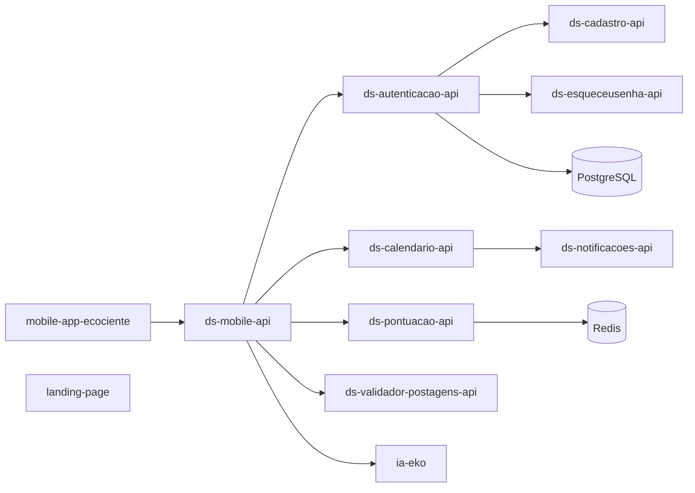

# EcoCiente — Instituto J&F

**Tecnologia a serviço da reciclagem, da educação ambiental e das cooperativas.**

---

## Índice

- [Sobre](#-sobre)
- [Arquitetura](#-arquitetura)
- [Repositórios](#-repositórios)
- [Tecnologias](#-tecnologias)
- [Padrões da organização](#-padrões-da-organização)
- [Como contribuir](#-como-contribuir)
- [Contato](#-contato)

---

## Sobre

O **EcoCiente** é um projeto desenvolvido por alunos do **Instituto J&F** que conecta moradores, síndicos e cooperativas de reciclagem. A plataforma reúne:

- **Calendário de coletas** de materiais recicláveis por região
- **Pontuação e ranking** para engajar a comunidade
- **Assistente de IA** multiagente para educação ambiental
- **Aplicativo mobile** e **landing page**
- **Autenticação** de usuários, cooperativas e síndicos

> [!NOTE]
> Esta organização reúne todos os repositórios do ecossistema EcoCiente: backend, mobile, IA, dados e infraestrutura.

---

## Arquitetura

> [!TIP]
> O diagrama é uma visão geral por domínio. Consulte o README de cada repositório para os detalhes de integração.

---

## Repositórios

### Mobile e Web

| Repositório | Descrição | Stack |
| --- | --- | --- |
| [mobile-app-ecociente](https://github.com/EcoCiente-Instituto-J-F/mobile-app-ecociente) | Aplicativo mobile do projeto |  |
| [landing-page](https://github.com/EcoCiente-Instituto-J-F/landing-page) | Página de apresentação do projeto |  |

### Backend — APIs (`ds-*`)

| Repositório | Descrição | Stack |
| --- | --- | --- |
| [ds-autenticacao-api](https://github.com/EcoCiente-Instituto-J-F/ds-autenticacao-api) | Login, cadastro de usuários e cooperativas, ativação de síndicos, recuperação de senha e tokens JWT |  |
| [ds-cadastro-api](https://github.com/EcoCiente-Instituto-J-F/ds-cadastro-api) | Cadastro de usuários no sistema |  |
| [ds-esqueceusenha-api](https://github.com/EcoCiente-Instituto-J-F/ds-esqueceusenha-api) | Recuperação de senha do usuário |  |
| [ds-calendario-api](https://github.com/EcoCiente-Instituto-J-F/ds-calendario-api) | Calendário de coletas por região, agendamentos recorrentes e avulsos, alterações, atrasos e cancelamentos |  |
| [ds-pontuacao-api](https://github.com/EcoCiente-Instituto-J-F/ds-pontuacao-api) | Concessão, estorno e restauração de pontos; rankings em Redis |   |
| [ds-validador-postagens-api](https://github.com/EcoCiente-Instituto-J-F/ds-validador-postagens-api) | Validação de postagens com modelo de ML |  |
| [ds-mobile-api](https://github.com/EcoCiente-Instituto-J-F/ds-mobile-api) | APIs consumidas pelo aplicativo mobile |  |
| [ds-notificacoes-api](https://github.com/EcoCiente-Instituto-J-F/ds-notificacoes-api) | API de notificações |  |
| [servlet-ecociente](https://github.com/EcoCiente-Instituto-J-F/servlet-ecociente) | Backend com Servlets, DAOs e operações CRUD |  |
| [ds-dad-api](https://github.com/EcoCiente-Instituto-J-F/ds-dad-api) | APIs utilizadas na disciplina de DAD |  |
| [dad-crud](https://github.com/EcoCiente-Instituto-J-F/dad-crud) | CRUD da disciplina de DAD |  |

### Inteligência Artificial

| Repositório | Descrição | Stack |
| --- | --- | --- |
| [ia-eko](https://github.com/EcoCiente-Instituto-J-F/ia-eko) | API em FastAPI, backend do sistema de IA multiagente do EcoCiente |   |

### Dados

| Repositório | Descrição | Stack |
| --- | --- | --- |
| [md-rpa-integration](https://github.com/EcoCiente-Instituto-J-F/md-rpa-integration) | Migração RPA/ETL do banco legado para o schema normalizado |  |
| [md-populador-pgsql](https://github.com/EcoCiente-Instituto-J-F/md-populador-pgsql) | Massa de dados: carga inicial de 500+ registros verossímeis para testes de volume |   |

### DevOps e Padronização

| Repositório | Descrição | Stack |
| --- | --- | --- |
| [devops-infra-ecociente](https://github.com/EcoCiente-Instituto-J-F/devops-infra-ecociente) | Infraestrutura como código, Cloud, Kubernetes e automações |   |
| [devops-repo-creator](https://github.com/EcoCiente-Instituto-J-F/devops-repo-creator) | Automação para criação de repositórios ([acessar o Criador](https://ecociente-repo-creator.vercel.app/docs)) |  |
| [ecociente-repo-template](https://github.com/EcoCiente-Instituto-J-F/ecociente-repo-template) | Template padrão para novos repositórios |  |
| [.github](https://github.com/EcoCiente-Instituto-J-F/.github) | Configurações globais que padronizam os demais repositórios |  |

---

## Tecnologias

---

## Padrões da organização

<b> Convenção de nomes de repositórios</b>

 

| Prefixo | Domínio |
| --- | --- |
| `ds-*` | APIs e serviços de backend (Desenvolvimento de Sistemas) |
| `md-*` | Modelagem de Dados |
| `ia-*` | Inteligência Artificial |
| `devops-*` | Infraestrutura e automação |
| `mobile-*` | Aplicativo mobile |
| `dad-*` | Projetos da disciplina de DAD |

<b>Criando um novo repositório</b>

 

> [!TIP]
> Você pode criar um repositório já no padrão EcoCiente **só acessando o [Criador de Repositórios](https://ecociente-repo-creator.vercel.app/docs)**, sem configurar nada manualmente.

**Como usar:**

1. Acesse o [Criador de Repositórios](https://ecociente-repo-creator.vercel.app/docs) e clique em **Entrar com GitHub** (apenas membros ativos da organização).
2. Informe o **nome** seguindo o padrão `<matéria>-<nome-do-repositório>` e a **descrição**.
3. Escolha a **visibilidade** (público ou privado).
4. Se for uma API, marque **Spring Boot** e preencha Group ID, Artifact ID e Package Name.
5. Revise e clique em **Confirmar e criar**.

**O que já vem configurado automaticamente:**

- Template oficial [`ecociente-repo-template`](https://github.com/EcoCiente-Instituto-J-F/ecociente-repo-template)
- Automação de PR herdada do template
- Licença **MIT**
- Ruleset **Proteção Main** na branch `main`
- Para APIs: Spring Boot 3.5.4, Java 19, Gradle, Docker, CI/CD, Spring Web, Springdoc/Swagger UI, Lombok e DevTools

> [!NOTE]
> Em repositórios privados, a Proteção Main depende do plano e das políticas da organização. Se o GitHub não permitir, o repositório é criado normalmente e você recebe um aviso.

Prefere manual? Use o botão **Use this template** em [`ecociente-repo-template`](https://github.com/EcoCiente-Instituto-J-F/ecociente-repo-template), siga o prefixo do domínio e mantenha a licença MIT.

<b>Configurações globais</b>

 

O repositório [`.github`](https://github.com/EcoCiente-Instituto-J-F/.github) centraliza as configurações compartilhadas entre os repositórios da organização.

---

## Como contribuir

1. Faça um **fork** do repositório desejado
2. Crie uma branch: `git checkout -b feat/minha-melhoria`
3. Faça o commit: `git commit -m "feat: minha melhoria"`
4. Envie: `git push origin feat/minha-melhoria`
5. Abra um **Pull Request**

> [!IMPORTANT]
> Antes de contribuir, leia o README do repositório e siga os padrões descritos acima.

> [!WARNING]
> Nunca versione credenciais, chaves JWT ou arquivos `.env`.

---

## 📬 Contato

**EcoCiente — Instituto J&F** 💚 Feito por alunos, para o planeta.

